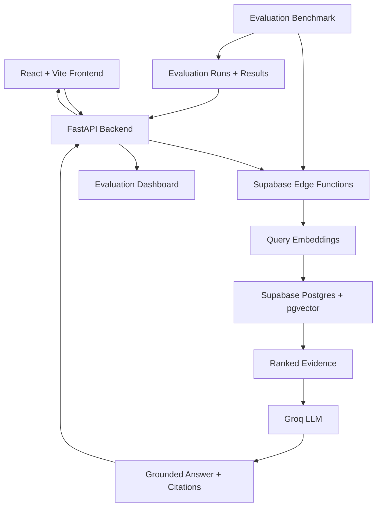

# AI Support Intelligence

**A production-style RAG application for grounded customer support answers, semantic retrieval, and measurable AI quality.**

AI Support Intelligence retrieves relevant knowledge-base content, generates answers grounded in that evidence, and exposes citations so users can inspect the sources behind each response. It also includes an evaluation dashboard for measuring retrieval quality, answer checks, and latency.

**Live Demo:** (https://ai-support-intelligence.pages.dev)  
**Backend API:** (https://ai-support-intelligence-bw5b.onrender.com)  
**API Documentation:** https://ai-support-intelligence-bw5b.onrender.com//docs

## Overview

Traditional LLM applications can produce plausible answers without reliable evidence. This project addresses that problem by combining semantic search, retrieval-augmented generation (RAG), source citations, and a repeatable evaluation benchmark.

The application provides three main workspaces:

- **AI Assistant:** Ask support questions and receive evidence-grounded answers with source citations.
- **Retrieval Explorer:** Inspect retrieved knowledge-base chunks and their similarity scores.
- **Evaluation Dashboard:** Review benchmark metrics, latency percentiles, individual test cases, and execution failures.

## Architecture



### Request flow

1. A user submits a support question through the React interface.
2. FastAPI validates the request and forwards it to a Supabase Edge Function.
3. The search function generates a query embedding using `gte-small`.
4. PostgreSQL with pgvector retrieves semantically relevant knowledge chunks.
5. The answer function sends the retrieved evidence to the Groq-hosted language model.
6. The application returns an answer with source citations and supporting evidence.
7. The evaluation benchmark measures retrieval and answer behavior against a labeled test dataset.

## Technology Stack

| Component | Technology | Purpose |
|---|---|---|
| Frontend | React, TypeScript, Vite | Interactive application and dashboard |
| Backend | Python, FastAPI | API endpoints, request validation, and metrics logging |
| Database | Supabase PostgreSQL | Persistent knowledge and evaluation data |
| Vector search | pgvector | Semantic similarity retrieval |
| Embeddings | `gte-small` | 384-dimensional text embeddings |
| AI generation | Groq API | Evidence-grounded answer generation |
| Serverless functions | Supabase Edge Functions | Embedding, retrieval, and answer orchestration |
| Testing | pytest | Backend API tests |
| Deployment | Cloudflare Pages and hosted FastAPI | Public frontend and backend |

## Evaluation and Benchmarking

The project includes a benchmark of **11 test cases: 9 answerable questions and 2 unanswerable questions**.

The evaluation pipeline measures retrieval relevance, ranking quality, required-fact coverage, citation identifier validity, answerability decisions, and latency.

### Recorded baseline

| Metric | Baseline |
|---|---:|
| Dataset size | 11 questions |
| Source Hit Rate@5 | 100% |
| Precision@5 | 20% |
| Recall@5 | 100% |
| Mean Reciprocal Rank (MRR) | 1.000 |
| nDCG@5 | 1.000 |
| Required-fact coverage | 83.33% |
| Citation-ID validity | 100% |
| Answerability decision accuracy | 100% |
| Retrieval latency P50 | 2.05 s |
| Retrieval latency P95 | 3.12 s |
| Answer latency P50 | 2.45 s |
| Answer latency P95 | 3.42 s |

*These are recorded benchmark results, not guaranteed production performance.*

### Interpreting the results

- **Source Hit Rate@5:** The expected source was retrieved within the top five results for each answerable benchmark question.
- **Precision@5:** Measures the proportion of retrieved top-five results considered relevant. The recorded 20% reflects the benchmark's relevance labels and retrieval depth.
- **Recall@5:** Measures how many expected relevant sources were retrieved.
- **MRR and nDCG@5:** Measure the position and ranking quality of relevant results.
- **Required-fact coverage:** Measures whether the benchmark's expected facts were detected in generated answers.
- **Citation-ID validity:** Checks whether citation identifiers correspond to returned evidence. It does not independently prove that every claim is entailed by its citation.
- **P50 and P95 latency:** Describe median and 95th-percentile response times observed during the benchmark.

**Known limitation:** One benchmark request encountered a Groq rate-limit error. Consequently, the recorded answer success rate of 90.91% includes an execution failure and should not be interpreted as a pure answer-quality score. The benchmark should be rerun to establish a more reliable baseline.

## Knowledge Base

The support knowledge base contains Markdown documents covering:

- Refund policies
- Shipping policies
- Account support
- Payment methods
- Order changes
- Damaged items
- Account security

The ingestion pipeline processes source documents into searchable chunks with associated metadata and embeddings.

## API Endpoints

| Method | Endpoint | Description |
|---|---|---|
| GET | `/health` | Health check |
| POST | `/api/chat` | Generate an evidence-grounded answer |
| POST | `/api/search` | Retrieve relevant knowledge chunks |
| GET | `/api/evaluations` | Retrieve saved benchmark runs and per-question results |

Interactive API documentation is available at `/docs` on the deployed FastAPI service.

## Run Locally

### Prerequisites

- Python 3.12 or a compatible Python version
- Node.js and npm
- A Supabase project with the required schema, pgvector extension, and Edge Functions configured
- A Groq API key configured for the answer-generation function

### 1. Clone the repository

```bash
git clone <YOUR_GITHUB_REPOSITORY_URL>
cd ai-support-intelligence
```

### 2. Configure the backend

Create a local `.env` file in the project root:

```env
SUPABASE_URL=your_supabase_project_url
SUPABASE_SERVICE_ROLE_KEY=your_server_side_service_role_key
```

Install dependencies and start FastAPI:

```bash
pip install -r requirements.txt
uvicorn backend.app.main:app --reload
```

The backend will be available at `http://127.0.0.1:8000`.

### 3. Configure the frontend

Create `frontend/.env`:

```env
VITE_API_BASE_URL=http://127.0.0.1:8000
```

Install dependencies and start Vite:

```bash
cd frontend
npm install
npm run dev
```

Open the local URL printed by Vite.

### 4. Run backend tests

From the project root:

```bash
python -m pytest -q
```

The backend environment variables must be configured for live integrations. Tests that mock external services can run without making real AI requests.

## Security Considerations

- Keep Supabase service-role credentials on the server.
- Keep Groq credentials in the Supabase Edge Function environment.
- Never expose secret keys through `VITE_` environment variables.
- Configure CORS to allow only the intended frontend origins.
- Apply appropriate access controls and Row Level Security policies to tables exposed through Supabase APIs.
- Do not assume chat privacy is enforced by account identity until authentication and per-user data isolation are implemented and tested.

## Current Limitations

- The benchmark is relatively small and may not represent all real-world support questions.
- Retrieval metrics depend on the benchmark's expected-source labels.
- Citation identifier validity is not the same as semantic citation faithfulness.
- External model rate limits can affect execution reliability and benchmark completeness.
- Latency depends on network conditions, hosting behavior, and external services.
- User authentication and account-based private conversation history are not yet part of the verified feature set.

## Future Improvements

- Expand the benchmark with more realistic questions and difficult unanswerable cases.
- Add semantic citation-faithfulness evaluation.
- Compare embedding models, chunking strategies, and retrieval configurations.
- Introduce authentication and per-user conversation isolation.
- Track evaluation history to measure quality changes across versions.
- Add automated benchmark execution to the development workflow.

## What This Project Demonstrates

- Building an end-to-end RAG application.
- Implementing semantic retrieval with PostgreSQL and pgvector.
- Integrating embedding and language-model APIs through server-side functions.
- Designing backend APIs with FastAPI.
- Evaluating retrieval quality and answer behavior with quantitative metrics.
- Instrumenting latency and request outcomes.
- Building and deploying an interactive React application.

---
### Optimization 1: HTTP Client Connection Pooling

Reused HTTP connections across requests to Supabase Edge Functions instead of creating a new HTTP client for every request.

**Reported benchmark results:**
- Retrieval latency P50: 45.93% reduction
- Retrieval latency P95: 34.55% reduction
- Answer latency P50: 43.75% reduction
- Answer latency P95: 30.04% reduction

These results measure latency improvements; retrieval quality, answer quality, and failure rates should also be checked to ensure the optimization preserves system behavior.
**Built as an AI engineering portfolio project focused on grounded generation, retrieval quality, evaluation, and measurable system behavior.**
